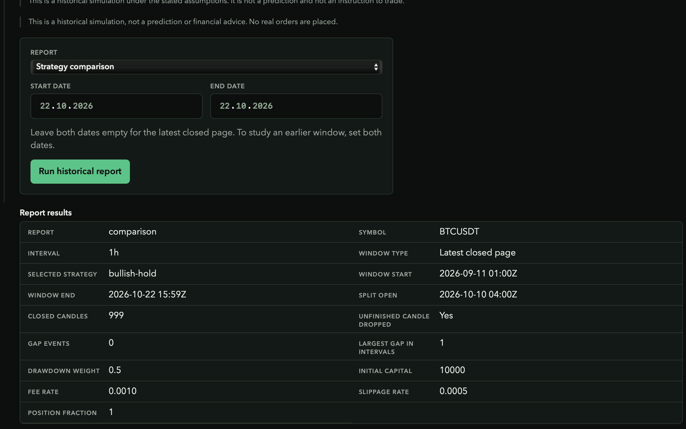
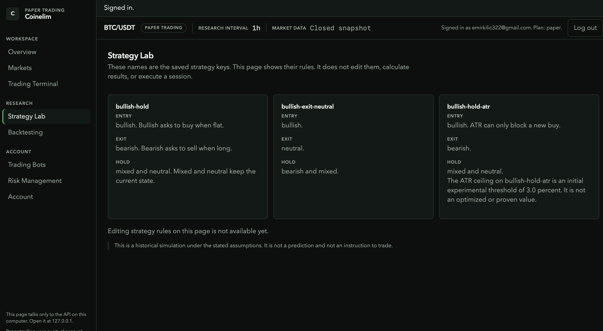
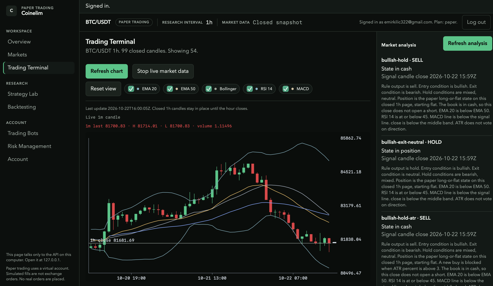

# coinelim-portfolio
A cryptocurrency trading and strategy research SaaS platform currently in development.
Coinelim

Cryptocurrency Strategy Research & Paper Trading Platform

Coinelim is a SaaS project in development focused on cryptocurrency market research, trading strategy evaluation, backtesting, and paper trading.

The goal is to build a structured environment for researching trading strategies, comparing their historical performance, and testing decision rules through simulated trading.

Project status: In active development.

Features

* Trading Dashboard — A web interface for navigating market research and trading tools.
* Trading Charts — Candlestick charts with technical indicators, including EMA, Bollinger Bands, RSI, and MACD.
* Strategy Research — Tools for examining and comparing rule-based trading strategies.
* Backtesting — Historical simulations with performance metrics, transaction fees, slippage, and drawdown measurements.
* Out-of-Sample Evaluation — Separate evaluation data to help assess strategies beyond the data used during development.
* Paper Trading — A simulated trading environment using virtual balances rather than real orders.
* Bot Configuration — Interfaces for configuring strategies, symbols, intervals, and parameters.

Technology

* Python
* JavaScript
* HTML and CSS
* SQLite
* Automated testing and historical simulation

Screenshots

Project screenshots will be added here to demonstrate the interface and research workflows.

Development Approach

The project emphasizes modular architecture, testable components, explicit trading assumptions, and careful evaluation of strategy performance.

Backtesting and paper-trading results are simulations. They do not guarantee future performance or profitability.

Disclaimer

Coinelim is a software development project. Screenshots and research results demonstrate development work, not a guarantee of investment returns.

⸻

Developer: Emir Kılıç
Location: Ankara, Türkiye
Contact: emirkilic322@gmail.com
## Screenshots

### Login Screen

### Strategy Comparison

### Paper Trading Configuration

### Trading Chart

